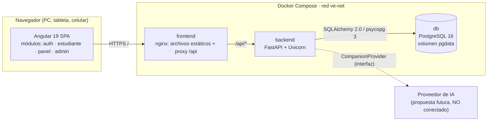
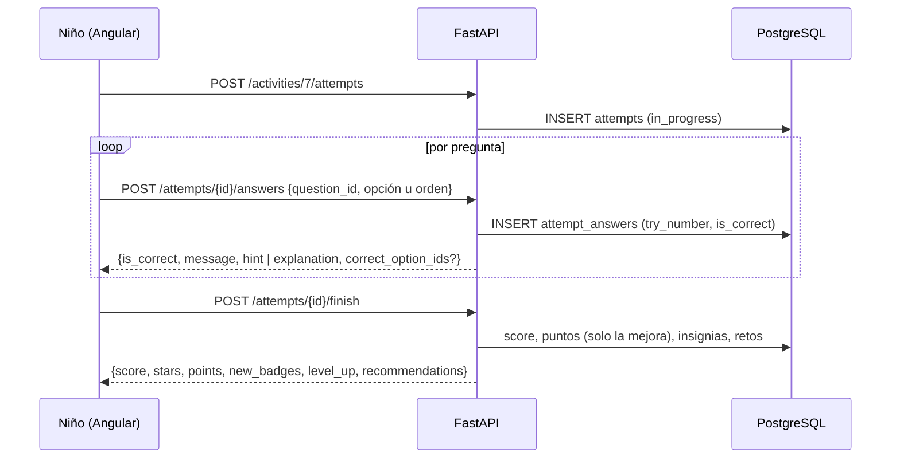

# Arquitectura de V&E Academy

## 1. Vista general



- **Cliente-servidor** con una SPA y una API REST. En Docker, nginx sirve la SPA y reenvía `/api` al backend: hay un solo origen y no se necesita CORS.
- **Backend por capas** (separación de responsabilidades):

```
routers/        HTTP: valida la entrada (Pydantic), aplica dependencias de seguridad y delega
services/       Lógica de negocio: evaluación, gamificación, progreso, permisos sobre menores
repositories/   Acceso a datos con SQLAlchemy 2.0 (consultas y agregados en PostgreSQL)
models/         Entidades ORM (tablas, restricciones, índices)
schemas/        Contratos de entrada/salida (Pydantic v2)
core/           Configuración, base de datos, seguridad (JWT/Argon2), manejo centralizado de errores
api/            Dependencias (usuario actual, require_roles) y agregación de routers
ai_companion/   Contratos, proveedor desactivado y filtros de seguridad (propuesta futura)
seed/           Datos iniciales idempotentes
```

- **Frontend modular** con componentes *standalone* (enfoque recomendado desde Angular 17) organizados por funcionalidad y cargados de forma diferida:

```
core/        modelos (tipos de la API), servicios HTTP por dominio, guards, interceptores, servicios de UI
shared/      componentes reutilizables: mascota, barras de habilidades, gráfico semanal, avisos/diálogo
features/
  auth/      ingresar, registro, recuperar y restablecer contraseña
  student/   inicio, biblioteca, lector, actividades, reproductor, logros
  adult/     marco administrativo, panel de estudiantes, reporte, aulas, perfil
  admin/     resumen, usuarios, lecturas, actividades, categorías, gamificación
```

## 2. Principios aplicados

| Principio | Dónde |
|-----------|-------|
| Responsabilidad única (S) | Router → Service → Repository; un servicio por dominio |
| Abierto/cerrado (O) | Las insignias y los retos se definen como datos (`criteria_type`), no como código; un proveedor de IA se agrega sin tocar el resto |
| Inversión de dependencias (D) | `CompanionProvider` (Protocol) y `get_companion_provider()`; los servicios dependen de repositorios, no de la sesión cruda |
| Seguridad por defecto | Rutas protegidas por defecto con `CurrentUser` / `require_roles`; un adulto solo ve a los niños que tiene asociados |
| Errores centralizados | `core/exceptions.py`: formato único `{"error": {code, message, details}}`; el `errorInterceptor` de Angular los traduce |
| Configuración por ambiente | `pydantic-settings` + `.env`; ningún secreto en el código; el backend rechaza el `JWT_SECRET_KEY` de ejemplo |

## 3. Seguridad (prioridad: usuarios menores de edad)

- **Contraseñas**: Argon2id (`argon2-cffi`). Login con el mismo costo aunque el usuario no exista (evita enumeración) y mensaje genérico.
- **JWT** HS256 con `jti` y expiración. **Logout real**: el `jti` queda en `revoked_tokens`. En el navegador el token vive en `sessionStorage` y se borra al cerrar.
- **Bloqueo** tras 5 intentos fallidos durante 10 minutos (configurable).
- **RBAC**: 4 roles. **Aislamiento de menores**: si un adulto pide un estudiante que no le pertenece, recibe `404` (no `403`), para no revelar que existe.
- **Minimización de datos**: el niño no tiene correo ni apellidos; la edad es opcional. Registro público solo para adultos, con aceptación de tratamiento de datos (Ley 1581 de 2012).
- **Respuestas correctas ocultas**: la vista del estudiante (`GET /activities/{id}`) nunca incluye `is_correct`, `correct_position` ni explicaciones.
- **Sin comparaciones entre niños**: no hay rankings; las tablas de aula se ordenan alfabéticamente.
- **Encabezados**: `X-Content-Type-Options`, `X-Frame-Options`, `Referrer-Policy` en la API y en nginx. PostgreSQL publicado solo en `127.0.0.1`.
- **Contenedores**: el backend corre con un usuario sin privilegios; los secretos se pasan por variables de entorno.

## 4. Flujo principal: resolver una actividad



## 5. Estructura del repositorio

```
V&E-Academy/
├── backend/
│   ├── app/{api,core,models,schemas,services,repositories,routers,seed,ai_companion}/
│   ├── alembic/ (migraciones)        ├── tests/ (pytest, PostgreSQL real)
│   ├── Dockerfile  docker-entrypoint.sh  requirements*.txt  alembic.ini  pytest.ini
├── frontend/
│   ├── src/app/{core,shared,features}/
│   ├── public/  angular.json  package.json  karma.conf.js  proxy.conf.json  nginx.conf  Dockerfile
├── database/
│   ├── init/01-create-test-db.sh     └── schema.sql (DDL generado desde las migraciones)
├── e2e/test_e2e.py (Playwright)
├── docs/ (análisis, arquitectura, modelo de datos, API, AI Companion)
├── docker-compose.yml  .env.example  .gitignore  README.md
```

## 6. Plan de desarrollo por módulos (fases ejecutadas)

| Fase | Entregable | Estado |
|------|------------|--------|
| 1. Análisis y arquitectura | `docs/01`, `docs/02` | ✔ |
| 2. Base de datos | Modelos, migración inicial, `database/schema.sql`, `docs/03` | ✔ |
| 3. Backend | 73 endpoints, servicios, seed | ✔ 47 pruebas pytest |
| 4. Frontend | 4 módulos funcionales, 31 componentes | ✔ 13 pruebas unitarias |
| 5. Integración | Proxy de desarrollo, nginx en producción | ✔ |
| 6. Pruebas | pytest + Karma + Playwright E2E (6 recorridos) | ✔ |
| 7. Docker | `docker-compose.yml`, Dockerfiles, healthchecks | ✔ Validado por partes (ver README) |
| 8. Documentación | README + `docs/` + Swagger | ✔ |
| 9. AI Companion | Contratos, filtros, endpoint de estado, `docs/05` | ✔ (sin IA real, por diseño) |

**Siguientes incrementos sugeridos**: PWA/instalable; audios grabados por docentes; carga de imágenes propias; exportar reportes a PDF; refresh tokens; registro de auditoría de accesos a datos de menores; CI en GitHub Actions.
