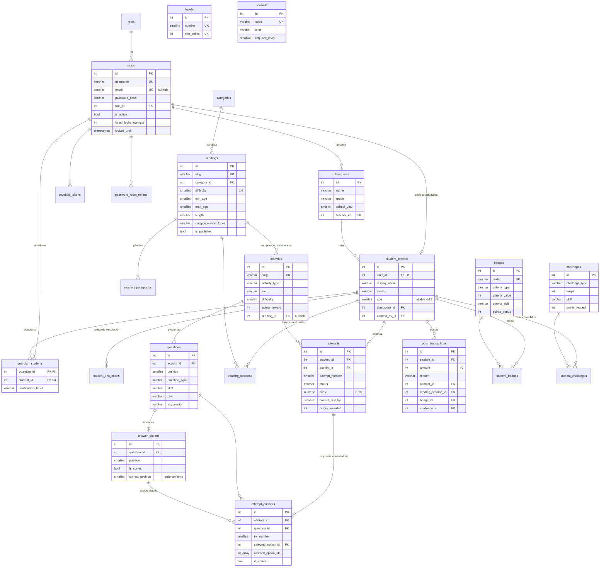

# Fase 2 · Modelo de datos (PostgreSQL 16)

Fuente de verdad: `backend/app/models/` → migración `backend/alembic/versions/20261106_0001_esquema_inicial.py`. DDL completo exportado en [`database/schema.sql`](../database/schema.sql).

Convenciones:

- Claves primarias `id` enteras (identity) y claves foráneas con nombre estable (`fk_<tabla>_<columna>_<referida>`).
- `created_at` / `updated_at` con `timestamptz` gestionados por la base de datos.
- Enumeraciones como `VARCHAR + CHECK`, para que agregar valores sea una migración simple.

## Diagrama entidad-relación

## Entidades y su justificación

| Entidad solicitada | Tabla(s) | Notas |
|--------------------|----------|-------|
| Usuarios, Roles | `users`, `roles` | Un usuario tiene un rol. El correo es opcional (los niños no lo tienen) |
| Estudiantes | `student_profiles` | Solo datos pedagógicos mínimos: nombre visible, avatar, edad opcional, aula |
| Docentes | `users` (rol `teacher`) + `classrooms` | Un docente no necesita más atributos que un usuario; lo que lo distingue son sus aulas. Una tabla `teachers` vacía sería redundante |
| Acudientes | `users` (rol `guardian`) + `guardian_students` | Relación N:M: un niño puede tener varios acudientes y un acudiente varios niños |
| Lecturas, Categorías | `readings`, `reading_paragraphs`, `categories` | Los párrafos van en su propia tabla (1FN): orden, ilustración e imagen por párrafo |
| Actividades, Preguntas, Opciones | `activities`, `questions`, `answer_options` | La comprensión de una lectura es una actividad con `reading_id`, así hay un solo motor de evaluación |
| Intentos | `attempts` | Resultado agregado por intento (puntaje, aciertos al primer intento, puntos) |
| Resultados | `attempt_answers` | Cada respuesta enviada, incluidos los reintentos (`try_number`) |
| Progreso | *Calculado* + `reading_sessions` | El progreso (porcentajes, habilidades, promedios) se **calcula** desde intentos y sesiones; guardarlo por separado duplicaría información y podría desincronizarse |
| Puntos | `point_transactions` | Libro contable: el total es `SUM(amount)`. Es auditable y no se duplica |
| Insignias, Logros | `badges`, `student_badges` | `student_badges` = logros obtenidos (PK compuesta: sin duplicados) |
| *Adicionales* | `levels`, `rewards`, `challenges`, `student_challenges` | Niveles, recompensas y retos (gamificación del documento, sección 2.4) |
| *Adicionales de seguridad* | `revoked_tokens`, `password_reset_tokens`, `student_link_codes` | Logout real, recuperación de contraseña y vinculación segura. Los tokens y códigos se guardan como hash SHA-256 |

## Restricciones e índices relevantes

- `CHECK`: `difficulty BETWEEN 1 AND 3`, `min_age <= max_age`, `points_reward BETWEEN 1 AND 100`, `score BETWEEN 0 AND 100`, `amount > 0`, `age BETWEEN 4 AND 12`, y los valores de cada enumeración.
- `UNIQUE`: `(activity_id, position)` en preguntas, `(question_id, position)` en opciones, `(reading_id, position)` en párrafos, `(attempt_id, question_id, try_number)` en respuestas, `(teacher_id, name, school_year)` en aulas.
- Índices sobre todas las FK de consulta frecuente, `(student_id, activity_id)` en intentos, `(student_id, reading_id)` en sesiones, `skill` en preguntas e `is_published` en contenidos.
- `ON DELETE`: `CASCADE` para datos que pertenecen al estudiante; `RESTRICT` para categorías con lecturas y para docentes con aulas; `SET NULL` para autores de contenido. Además, el servicio **impide borrar** lecturas o actividades que ya tienen historial (se despublican), para no perder datos de aprendizaje.

## Reglas de negocio

| Regla | Valor |
|-------|-------|
| Primera lectura completa de un cuento | +10 puntos |
| Relectura (fortalece la fluidez) | +2 puntos |
| Actividad | `round(points_reward × % de aciertos al primer intento)`; en intentos posteriores **solo se suma la mejora** |
| Intentos por pregunta | 2. Tras el 1.º error, pista; tras el 2.º, se muestra la respuesta con su explicación |
| Puntaje | Aciertos al primer intento / total × 100 |
| Estrellas | 3 si 100 %, 2 si ≥ 60 %, 1 al terminar |
| Estado de una habilidad (con ≥ 3 respuestas) | ≥ 80 % *fortalecida*, < 60 % *necesita refuerzo*, en otro caso *en desarrollo* |
| Recomendaciones | Actividades de la habilidad más débil que no tengan un mejor puntaje ≥ 80 %; si no hay, actividades nuevas variando el tipo |
| Niveles | 0 / 40 / 100 / 200 / 350 / 550 puntos |
| Retos | Cuentan desde la fecha de creación del reto; otorgan el bono una sola vez |
| Avance del catálogo | (lecturas distintas + actividades distintas completadas) / (publicadas) |
