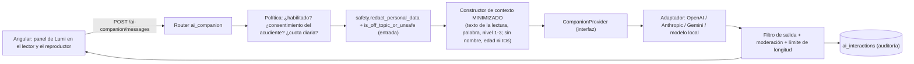

# V&E AI Companion — "Mi compañero de aprendizaje"

> **Propuesta futura.** Esta funcionalidad **no hace parte de los requerimientos del documento original** de V&E Academy. El póster del proyecto menciona "inteligencia artificial básica" y "aprendizaje adaptativo" como tecnologías emergentes, pero sin una especificación funcional.
>
> En la versión 1.0 **no hay ningún servicio de IA conectado**. Lo que sí existe y está probado: los contratos de integración, un proveedor desactivado que rechaza las solicitudes, los filtros de seguridad deterministas y un endpoint que informa el estado real.

## 1. Lo que ya existe en el código

| Pieza | Ruta | Estado |
|-------|------|--------|
| Contratos (`CompanionProvider`, `CompanionRequest`, `CompanionContext`, `CompanionReply`) | `backend/app/ai_companion/contracts.py` | Listo |
| Proveedor desactivado (lanza 503, no inventa respuestas) | `backend/app/ai_companion/providers.py` | Listo, probado |
| Filtros: ocultar datos personales (correo, teléfono, dirección, URL) y bloquear temas ajenos | `backend/app/ai_companion/safety.py` | Listo, probado |
| `GET /api/v1/ai-companion/status` | `backend/app/routers/system.py` | Responde `enabled:false, available:false` |
| Indicador en el panel de administración | `frontend/.../admin-overview.component.ts` | Muestra "Propuesta futura" |
| Bandera `AI_COMPANION_ENABLED` | `core/config.py`, fija en `false` en `docker-compose.yml` | — |

## 2. Funcionalidades propuestas

1. **Acompañamiento en la lectura**: explicar una palabra desconocida, dar una pista, hacer una pregunta sencilla y animar a seguir.
2. **Aprendizaje personalizado**: adaptar la explicación a la dificultad del texto; recomendar refuerzo usando `ProgressService.recommendations()`, que ya existe y es determinista.
3. **Asistente conversacional**: Lumi como personaje; respuestas de máximo 2-3 frases; solo temas de lectura.
4. **Acompañamiento pedagógico**: pistas sin revelar la respuesta, felicitaciones y explicación positiva de los errores.

## 3. Arquitectura propuesta



La **inversión de dependencias** permite cambiar de proveedor registrando una clase en `_REGISTRY` sin modificar routers ni servicios.

## 4. Endpoints futuros (contrato)

| Método | Ruta | Rol | Descripción |
|--------|------|-----|-------------|
| GET | `/api/v1/ai-companion/status` | Todos | **Ya existe** |
| POST | `/api/v1/ai-companion/messages` | Estudiante | `{intent, child_message?, reading_id?, question_id?, target_word?}` → `CompanionReply` |
| GET | `/api/v1/students/{id}/ai-interactions` | Docente / acudiente | Supervisión: historial de conversaciones del niño |
| PUT | `/api/v1/students/{id}/ai-consent` | Acudiente | Activar o desactivar el acompañante para su niño |
| GET/PUT | `/api/v1/admin/ai-settings` | Admin | Proveedor, cuotas, lista de temas permitidos |

Mientras `AI_COMPANION_ENABLED=false`, estos endpoints **no se registran**. No se exponen rutas que simulen respuestas.

## 5. Modelo de datos propuesto (no migrado todavía)

```sql
CREATE TABLE ai_consents (
  student_id   INT PRIMARY KEY REFERENCES student_profiles(id) ON DELETE CASCADE,
  guardian_id  INT NOT NULL REFERENCES users(id),
  granted      BOOLEAN NOT NULL,
  updated_at   TIMESTAMPTZ NOT NULL DEFAULT now()
);
CREATE TABLE ai_interactions (
  id            BIGINT GENERATED ALWAYS AS IDENTITY PRIMARY KEY,
  student_id    INT NOT NULL REFERENCES student_profiles(id) ON DELETE CASCADE,
  intent        VARCHAR(30) NOT NULL,
  reading_id    INT REFERENCES readings(id) ON DELETE SET NULL,
  question_id   INT REFERENCES questions(id) ON DELETE SET NULL,
  child_message VARCHAR(200),          -- ya filtrado (datos personales ocultos)
  reply_text    VARCHAR(400) NOT NULL,
  flagged       BOOLEAN NOT NULL DEFAULT false,
  provider      VARCHAR(40) NOT NULL,
  created_at    TIMESTAMPTZ NOT NULL DEFAULT now()
);
CREATE INDEX ix_ai_interactions_student_created ON ai_interactions(student_id, created_at DESC);
-- Retención sugerida: borrar después de 90 días.
```

## 6. Consideraciones de seguridad (niños de 6-7 años)

- **Consentimiento** explícito del acudiente antes de activar el acompañante (Ley 1581 de 2012, art. 7: datos de niños).
- **Supervisión**: docentes y acudientes ven todas las conversaciones; no hay conversaciones privadas.
- **Minimización**: al proveedor solo se envía el fragmento de la lectura, la palabra y la dificultad, nunca nombre, edad, aula ni identificadores. Se redactan correos, teléfonos, direcciones y URL.
- **Alcance cerrado**: el *system prompt* limita las respuestas a la lectura; los temas ajenos reciben `SAFE_FALLBACK`; nunca se piden datos personales.
- **Sin etiquetas ni diagnósticos**: prohibido emitir juicios psicológicos o sobre capacidades ("eres lento", "tienes dislexia").
- **Pedagogía**: pistas graduales; no entregar la respuesta directa en preguntas evaluables.
- **Filtro de salida**: moderación del proveedor, longitud máxima, lista de términos bloqueados y registro de `flagged`.
- **Proveedor**: contrato de tratamiento de datos (DPA), sin uso de datos para entrenamiento, preferir la región más cercana; evaluar un modelo local (por ejemplo vía Ollama) para no transferir datos.
- **Cuotas** por estudiante y día; **apagado** inmediato con la bandera.

## 7. Posibles proveedores

| Opción | Ventajas | A considerar |
|--------|----------|--------------|
| Anthropic (Claude) | Buen seguimiento de instrucciones y del tono; políticas de uso para menores | Costo por token; requiere acuerdo de datos |
| OpenAI | Ecosistema amplio, API de moderación | Igual que el anterior |
| Google (Gemini) | Integración con Google Workspace for Education | Igual que el anterior |
| Modelo abierto local (Llama, Mistral, Qwen) | Los datos no salen de la institución | Requiere hardware (GPU) y mayor esfuerzo de evaluación y seguridad |

## 8. Pasos para implementarlo

1. Migración con `ai_consents` y `ai_interactions`.
2. Adaptador que cumpla `CompanionProvider` y registrarlo en `_REGISTRY`.
3. Router `/ai-companion/messages` condicionado a la bandera y al consentimiento.
4. Pruebas: ningún dato personal llega al proveedor (simulado), temas ajenos bloqueados y límites de longitud.
5. Piloto supervisado con docentes antes de abrirlo a los estudiantes.
